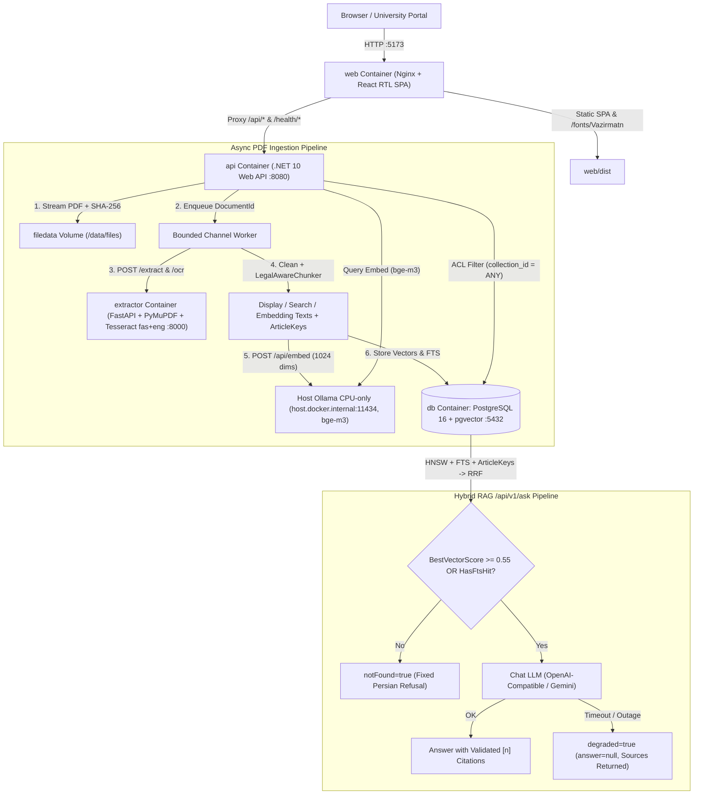

# DocSearch

[](https://github.com/nimagh05/B.Sc.-Final-Project/actions/workflows/ci.yml)

Persian RAG (Retrieval-Augmented Generation) document search web service. Users upload PDF documents (university regulations, guidelines, research papers) and ask natural-language questions in Persian or English; the system answers strictly from indexed documents with exact file name and page citations, refuses out-of-scope questions, and degrades gracefully to retrieval-only results when the chat LLM is unavailable.

---

## Highlights & Verified Evaluation Results

- **Hybrid Persian Legal-Aware RAG:** Combines PyMuPDF extraction, header/footer cleaning, legal structure chunking (`فصل`, `ماده`, `تبصره`), PostgreSQL `pgvector` HNSW dense search (`bge-m3`, 1024 dims), PostgreSQL `simple` FTS, and canonical `ArticleKeys` matching fused via Reciprocal Rank Fusion (RRF).
- **Selective OCR for Defective Persian PDFs:** Automatically detects image-only scans and CMap/ToUnicode font-corrupted documents (`Extraction:OcrMode=Defective`) and routes only defective documents/pages to Tesseract (`fas+eng`).
- **Role-Based Access Control & Production Hardening:** ASP.NET Core Identity + JWT Bearer auth, per-collection ACLs (`Viewer`, `Editor`, `Owner`, plus global `Admin`), two-layer auth/ask/upload rate limiting (`429 Retry-After`), RFC 7807 `ProblemDetails`, strict CORS, and trusted proxy CIDR support.
- **RTL React Web UI & Embeddable Widget:** Self-hosted `Vazirmatn` typography, `<bdi>` mixed-script isolation, upload progress with live ingestion polling, clickable `[n]` source citations, authenticated PDF download/viewing, `DegradedBanner` fallback, and a Shadow-DOM `<docsearch-widget>` Web Component ([Integration Guide](docs/INTEGRATION.md#5-embeddable-widget-docsearch-widget)).
- **Empirical Thesis Benchmark (`docs/EVAL-RESULTS.md`):**
  - Evaluated on `eval-dataset-v2.2` ($N=138$ unique questions across 14 digital PDFs + 8 Regime B scanned-twin evaluations).
  - **Stage 1 Retrieval:** Overall MRR `0.8500` (Vector-Only) / `0.7822` (Full System); on the 150 DPI scanned twin (`bein-almelali-scan.pdf`, $N=8$), Selective OCR recovered MRR from `0.000` to `0.875` (Recall@5 `100.0%`, `6/8` answered end-to-end vs `0/8` OCR-Off).
  - **Stage 2 End-to-End ($\tau = 0.55$):** Overall answer rate `88.4%`–`89.3%`, held-out Not-in-Docs False Acceptance Rate `0.0%` (`0/12`) for Vector and Full System, CMap digit-corruption errors on `heldout-CMap` reduced from `7/27` (`25.9%`) to `1/27` (`3.7%`), retrieval median latency `~200 ms`, end-to-end median latency `2.1–3.3 s`.

See [docs/EVAL-RESULTS.md](docs/EVAL-RESULTS.md) and the evaluation plots in [docs/figures/](docs/figures/) (`plot1_stage2_quality_comparison.png`, `plot2_threshold_tradeoff_curves.png`, `plot3_ocr_generation_impact.png`) for full tables, confidence intervals, and caveats.

---

## Architecture



---

## Setup From Zero on Windows (PowerShell)

### Prerequisites

- **Windows 10/11** with **PowerShell** and **Docker Desktop** (WSL2 backend). On 12 GB RAM machines, keep Docker/WSL2 capped (see Troubleshooting).
- **.NET 10 SDK** (`10.0.x`, pinned by `global.json`) — required for applying EF Core migrations and running/testing the API locally.
- **Ollama** running on the Windows host (CPU-only, outside Docker):
  ```powershell
  $env:CUDA_VISIBLE_DEVICES = "-1"
  ollama serve
  ollama pull bge-m3
  ollama list
  ```
- **Optional (local dev / eval only):** **Node.js 24 LTS** (`web/`), **Python 3.11+** with `.venv` (`eval/`, `conformance/`, or host `tools/extractor`).

### 1. Create `.env`

```powershell
Copy-Item .env.example .env
```

Edit `.env` (never commit `.env`) and set strong values for:
- `POSTGRES_PASSWORD`
- `Jwt__SigningKey` (at least 32 characters)
- `Auth__BootstrapAdmin__Email` and `Auth__BootstrapAdmin__Password` (≥ 10 chars, upper + lower + digit)
- `Ai__Chat__ApiKey` (your OpenAI-compatible / Gemini API key; leave empty to test retrieval-only degraded mode)

---

### Option A: One-Command Full Docker Stack (`db`, `extractor`, `api`, `web`)

> [!IMPORTANT]
> `DocSearch.Api` intentionally does **not** run `Database.MigrateAsync()` on startup in `Production` mode (`src/DocSearch.Api/Program.cs`). On a fresh database volume (`dbdata`), apply EF Core migrations **before** starting `api` so `AdminBootstrapSeeder` can create roles and the bootstrap admin user. (If `api` starts before migrations exist, run migrations and then run `docker compose --profile full restart api`.)

```powershell
# 1. Start PostgreSQL + pgvector and wait until healthy
docker compose up -d --wait db

# 2. Load .env variables into PowerShell and apply EF Core migrations
. .\scripts\load-env.ps1
dotnet ef database update --project src/DocSearch.Infrastructure --startup-project src/DocSearch.Api

# 3. Build and start the full stack (db, extractor, api, web)
docker compose --profile full up -d --build

# 4. Verify container health and endpoints
docker compose --profile full ps
Invoke-WebRequest http://localhost:5173/health/live | Select-Object StatusCode, Content
Invoke-WebRequest http://localhost:5173/health/ready | Select-Object StatusCode, Content
```

- **Web UI (RTL):** `http://localhost:5173` (Nginx serves the SPA and proxies `/api/` and `/health/` to `api:8080`)
- **API & Scalar Docs:** `http://localhost:5000/scalar/v1` (OpenAPI JSON at `http://localhost:5000/openapi/v1.json`)
- **Stop containers (keeps `dbdata` and `filedata` volumes):**
  ```powershell
  docker compose --profile "*" down
  ```

*(Deploying to a host without the .NET SDK? Generate an idempotent SQL script once on a dev machine with `dotnet ef migrations script --idempotent -p src/DocSearch.Infrastructure -s src/DocSearch.Api -o init.sql` and apply it via `Get-Content init.sql | docker compose exec -T db psql -U postgres -d docsearch`.)*

---

### Option B: Day-to-Day Local Development (Lower RAM)

Running only `db` and `extractor` in Docker while running the API and Vite dev server on the host uses less memory on 12 GB RAM laptops:

```powershell
# Terminal 1 — DB + Extractor sidecar + API
docker compose up -d db extractor
. .\scripts\load-env.ps1
dotnet ef database update --project src/DocSearch.Infrastructure --startup-project src/DocSearch.Api
dotnet run --project src/DocSearch.Api

# Terminal 2 — React + Vite dev server (proxies /api and /health to http://localhost:5000)
Set-Location web
npm ci
npm run dev
```

*(A single `.env` works for both Option A and Option B: `.env.example` sets host loopback addresses `127.0.0.1` for Postgres, Extractor, and Ollama during `dotnet run`, while `docker-compose.yml` automatically maps `Host=db`, `http://extractor:8000`, and `${DOCKER_EMBEDDING_ENDPOINT:-http://host.docker.internal:11434}` inside containers. For Python sidecar local dev without Docker `extractor`, `docker compose up -d db` alone is enough if you run `uvicorn app.main:app` from `tools/extractor`.)*

---

## Configuration Reference

Settings follow ASP.NET Core configuration hierarchy (`appsettings.json`, environment variables using `__`, or `dotnet user-secrets` in Development).

### Database & Compose

| Key / Env Var | Default | Notes |
|---|---|---|
| `COMPOSE_PROJECT_NAME` | `docsearch` | Prefix for Docker containers/volumes (`<name>_db`, `<name>_filedata`) |
| `DB_PORT` / `API_PORT` / `WEB_PORT` / `EXTRACTOR_PORT` | `5432` / `5000` / `5173` / `8000` | Host port mappings |
| `POSTGRES_DB` / `POSTGRES_USER` / `POSTGRES_PASSWORD` | `docsearch` / `postgres` / *(required)* | Postgres container credentials |
| `ConnectionStrings__Default` | `Host=127.0.0.1;Port=5432;...` | Built automatically for Docker `api` (`Host=db`) and by `load-env.ps1` |

### Auth & JWT

| Key (`:` in JSON, `__` in Env) | Default | Notes |
|---|---|---|
| `Auth:AllowSelfRegistration` | `true` | Enables `POST /api/v1/auth/register` |
| `Auth:BootstrapAdmin:Email` | `null` | Idempotent startup `Admin` seed email |
| `Auth:BootstrapAdmin:Password` | `null` | ≥ 10 chars with upper, lower, and digit |
| `Jwt:Issuer` / `Jwt:Audience` | `docsearch` / `docsearch` | Token issuer & audience |
| `Jwt:SigningKey` | `""` *(required)* | Symmetric signing key; **must be ≥ 32 chars** |
| `Jwt:ExpiryMinutes` | `60` | Access token lifetime (`1..43200`) |

### Extraction & Selective OCR

| Key | Default (`appsettings.json`) | Docker Compose Default | Notes |
|---|---|---|---|
| `Extraction:Provider` | `Sidecar` | `Sidecar` | Sidecar HTTP PDF extractor (`tools/extractor`) |
| `Extraction:ExtractorBaseUrl` | `http://127.0.0.1:8000` | `http://extractor:8000` | Sidecar base URL |
| `Extraction:OcrMode` | `null` (`Off`) | `Defective` | `Off` \| `Defective` \| `Always` (ADR 0009) |
| `Extraction:OcrEnabled` | `false` | — | Legacy bool; maps to `Defective` if `OcrMode` is `null` |
| `Extraction:OcrDpi` | `300` | `300` | Render DPI (`72..600`) |
| `Extraction:OcrBatchSize` | `5` | `5` | Pages per `/ocr` call (`1..50`) |
| `Extraction:OcrLanguages` | `fas+eng` | `fas+eng` | Tesseract traineddata languages |
| `Extraction:MinPageQuality` | `0.35` | `0.35` | Threshold below which `NeedsOcr = true` (`0..1`) |

### AI Embedding & Chat

| Key | Default | Notes |
|---|---|---|
| `Ai:Embedding:Provider` | `Ollama` | `Ollama` \| `OpenAICompatible` \| `Fake` |
| `Ai:Embedding:Model` | `bge-m3` | Stored per chunk; triggers reindex check when swapped (ADR 0007) |
| `Ai:Embedding:Endpoint` | `http://127.0.0.1:11434` | Host `dotnet run` endpoint; Docker Compose sets `${DOCKER_EMBEDDING_ENDPOINT:-http://host.docker.internal:11434}` |
| `Ai:Embedding:ApiKey` | `null` | Used only when `Provider=OpenAICompatible` |
| `Ai:Embedding:Dimensions` | `1024` | Must match `vector(1024)` schema (`EmbeddingConstants.VectorDimensions`) |
| `Ai:Embedding:QueryPrefix` / `PassagePrefix` | `""` / `""` | Empty for `bge-m3`; set `"query: "` / `"passage: "` for E5 models |
| `Ai:Embedding:BatchSize` / `NumThread` | `4` / `3` | CPU-safe Ollama batching & thread cap |
| `Ai:Embedding:KeepAlive` / `Truncate` | `5m` / `false` | `Truncate=false` prevents silent context truncation |
| `Ai:Embedding:PauseBetweenBatchesMs` / `TimeoutSeconds` | `0` / `120` | `TimeoutSeconds` range `1..600` |
| `Ai:Chat:Provider` | `OpenAICompatible` | `OpenAICompatible` \| `Ollama` \| `Fake` |
| `Ai:Chat:Model` | `gemini-3.5-flash-lite` | Chat model identifier |
| `Ai:Chat:Endpoint` | `https://generativelanguage.googleapis.com/v1beta/openai/` | OpenAI-compatible chat base URL |
| `Ai:Chat:ApiKey` | `null` | Set via `.env` or `dotnet user-secrets` |
| `Ai:Chat:TimeoutSeconds` / `Temperature` / `MaxOutputTokens` | `60` / `0.1` / `1024` | Bounds: `1..300` s, `0..2.0`, `1..8192` tokens |

### RAG & Chunking

| Key | Default | Notes |
|---|---|---|
| `Rag:TopK` / `CandidateK` | `6` / `30` | `CandidateK >= TopK` (`TopK` `1..20`, `CandidateK` `1..100`) |
| `Rag:MinSimilarity` | `0.55` | Pre-LLM gating threshold (`0..1`); bypassed if `HasFtsHit` |
| `Rag:MaxContextTokens` | `4000` | Prompt context token budget (`100..32000`) |
| `Rag:UseHybrid` / `RrfK` | `true` / `60` | Hybrid HNSW + FTS + `ArticleKeys` via RRF (`1..1000`) |
| `Rag:ReturnSourcesWhenNotFound` | `false` | Whether `notFound=true` omits or attaches nearest chunks |
| `Rag:PromptVersion` / `Temperature` | `v1` / `0.1` | Loads `Prompts/system.v1.txt` |
| `Chunking:TargetTokens` / `MaxTokens` / `MinTokens` | `425` / `500` / `80` | `MinTokens < TargetTokens <= MaxTokens` |
| `Chunking:OverlapRatio` / `RespectLegalStructure` | `0.15` / `true` | Same-section sentence overlap (`0..0.5`) |
| `Chunking:IncludeSectionTitleInEmbedding` | `true` | Prepends section title to `EmbeddingText` |
| `Chunking:PersianMultiplier` / `LatinMultiplier` / `SymbolsPerToken` | `1.45` / `2.25` / `12` | Calibrated P90 token estimator constants (ADR 0002 / 0003) |

### Storage, Ingestion, Rate Limiting, CORS, Network & Diagnostics

| Key | Default | Notes |
|---|---|---|
| `Storage:RootPath` / `MaxUploadMb` | `./data/files` / `50` | Docker sets `/data/files`; Kestrel allows +50 MB headroom (ADR 0006) |
| `Ingestion:MaxConcurrentDocuments` / `QueueCapacity` | `1` / `100` | Single-worker sequential ingestion protects 12 GB RAM CPU host |
| `RateLimiting:Enabled` | `true` | Emits RFC 7807 `429 rate.limited` + `Retry-After` |
| `RateLimiting:AuthPermitLimit` / `AuthIpPermitLimit` / `AuthWindowMinutes` | `10` / `100` / `1` | Per `IP:account` & global per-IP anti-spraying (ADR 0006) |
| `RateLimiting:AskPermitLimit` / `AskWindowMinutes` | `30` / `1` | Per authenticated user |
| `RateLimiting:UploadPermitLimit` / `UploadWindowHours` | `20` / `1` | Per authenticated user |
| `Cors:AllowedOrigins` | `["http://localhost:5173"]` | Strict allow-list (`AllowCredentials`); configurable via `Cors__AllowedOrigins__0` |
| `Network:TrustedProxyCidrs` | `[]` | CIDR list (e.g. Docker bridge or Nginx IP) trusted for `X-Forwarded-For` / `X-Forwarded-Proto` (`ForwardLimit=1`, ADR 0006) |
| `Docs:Enabled` | `true` | Exposes `/openapi/v1.json` and `/scalar/v1` |
| `Diagnostics:EnableEvalEndpoints` / `ExposeTimings` | `false` / `false` | Enables `POST /api/v1/dev/retrieve` and `X-Timing-*` headers |

---

## API Summary

Base REST path: `/api/v1` (JWT Bearer required unless marked **Anonymous**; errors return RFC 7807 `application/problem+json`).

| Group | Method & Path | Auth / Role | Purpose & Status |
|---|---|---|---|
| **Auth** | `POST /api/v1/auth/register` | Anonymous | Self-registration (`201`, gated by `Auth:AllowSelfRegistration`) |
| **Auth** | `POST /api/v1/auth/login` | Anonymous | Obtain JWT access token (`200`) |
| **Auth** | `GET /api/v1/auth/me` | Authenticated | Current user id, email, global roles (`200`) |
| **Collections** | `GET /api/v1/collections` | Authenticated | List readable collections (`?page=&pageSize=`, `200`) |
| **Collections** | `POST /api/v1/collections` | Authenticated | Create collection (`201`, caller becomes `Owner`) |
| **Collections** | `GET /api/v1/collections/{id}` | Viewer+ | Collection metadata & document count (`200` / `404`) |
| **Collections** | `PUT /api/v1/collections/{id}` | Editor+ | Update collection name/description (`200`) |
| **Collections** | `DELETE /api/v1/collections/{id}` | Owner | Delete collection, documents, chunks, stored files (`204`) |
| **Members** | `GET /api/v1/collections/{id}/members` | Owner | List collection members & roles (`200`) |
| **Members** | `PUT /api/v1/collections/{id}/members` | Owner | Upsert member role (`Viewer` \| `Editor` \| `Owner`, `200`) |
| **Members** | `DELETE /api/v1/collections/{id}/members/{userId}` | Owner | Remove non-owner member (`204`) |
| **Documents** | `POST /api/v1/collections/{collectionId}/documents` | Editor+ | Multipart PDF upload (`%PDF-`, SHA-256 dedup, `202`) |
| **Documents** | `GET /api/v1/collections/{collectionId}/documents` | Viewer+ | Paged document list (`?page=&pageSize=&status=`, `200`) |
| **Documents** | `GET /api/v1/documents/{id}` | Viewer+ | Document detail (`ocrPages`, `chunkCount`, `errorMessage`, `200`) |
| **Documents** | `GET /api/v1/documents/{id}/file` | Viewer+ | Download original PDF (`application/pdf`, `200`) |
| **Documents** | `DELETE /api/v1/documents/{id}` | Editor+ | Delete document, chunks, and file (`204`) |
| **Documents** | `POST /api/v1/documents/{id}/reprocess` | Editor+ | Re-enqueue document ingestion (`202` / `409`) |
| **RAG** | `POST /api/v1/ask` | Authenticated | Ask over `1..20` readable collections (`200`; supports `notFound` & `degraded`) |
| **RAG (Eval)** | `POST /api/v1/dev/retrieve` | Authenticated | Retrieval debug endpoint (`404` unless `Diagnostics:EnableEvalEndpoints=true`) |
| **History** | `GET /api/v1/conversations` | Owner (User) | Paged user conversations (`200`) |
| **History** | `GET /api/v1/conversations/{id}/messages` | Owner (User) | Messages with `sources`, `degraded`, `notFound` (`200`) |
| **History** | `DELETE /api/v1/conversations/{id}` | Owner (User) | Delete conversation (`204`) |
| **Admin** | `POST /api/v1/admin/collections/{id}/reindex` | Admin | Start resumable collection re-index job (`202`) |
| **Admin** | `GET /api/v1/admin/reindex-jobs/{jobId}` | Admin | Poll re-index progress (`200`) |
| **Ops & Docs** | `GET /health/live` · `GET /health/ready` | Anonymous | Liveness (`200`) and DB/extractor/embedding readiness (`200` / `503`) |
| **Ops & Docs** | `GET /openapi/v1.json` · `GET /scalar/v1` | Anonymous | OpenAPI spec & Scalar UI when `Docs:Enabled=true` |

---

## Architecture Decision Records (ADR Index)

| ADR | Title | Summary |
|---|---|---|
| [0001](docs/adr/0001-record-architecture-decisions.md) | Record Architecture Decisions | Adopts Nygard-format ADRs under `docs/adr/` for significant technical decisions. |
| [0002](docs/adr/0002-pdf-extractor-and-embedding-model.md) | PDF Extractor, Embedding Model & Token Calibration | Chooses PyMuPDF HTTP sidecar (`AGPL-3.0`), `bge-m3` (`vector(1024)`), and calibrated P90 token multipliers (`1.45` / `2.25`). |
| [0003](docs/adr/0003-chunking-strategy-and-evaluation.md) | Persian Legal-Aware Chunking & Defect Detection | Defines `HeaderFooterCleaner`, `LegalAwareChunker` (425 target / 500 max tokens), and CMap defect detection. |
| [0004](docs/adr/0004-post-t06b-chunker-and-rag-hardening.md) | Post-T06b Chunker Fix & RAG Hardening | Fixes article marker boundary timing, hardens refusal detection, and adds pre-LLM conversation ACL check. |
| [0005](docs/adr/0005-hybrid-retrieval-and-article-keys.md) | Hybrid Retrieval, `ArticleKeys` & RRF | Adds canonical `article_keys` GIN index, `LegalReferenceExtractor`, `TsQueryBuilder`, and sequential hybrid search. |
| [0006](docs/adr/0006-two-layer-auth-rate-limiting-and-upload-headroom.md) | Two-Layer Auth Rate Limiting, Proxy CIDRs & Upload Headroom | Pairs IP anti-spraying with `IP:account` brute-force limits, strict proxy CIDRs, and +50 MB Kestrel headroom for clean 413s. |
| [0007](docs/adr/0007-reindex-and-provider-swap.md) | Collection Re-indexing & Provider/Dimension Swap | Adds crash-resumable `ReindexWorker` and documents same-dimension swaps vs dimension-changing migrations. |
| [0008](docs/adr/0008-eval-dataset-v2-heldout-and-defect-tags.md) | Evaluation Dataset v2.2 & OCR Protocol | Freezes 138-question `tuned`/`heldout` split, defect tags (`cmap`/`screenshot`), and isolated Regime B scan twin protocol. |
| [0009](docs/adr/0009-ocr-sidecar-and-modes.md) | OCR Sidecar Architecture & Modes | Introduces `OcrMode` (`Off` \| `Defective` \| `Always`), document-wide CMap propagation, `OMP_THREAD_LIMIT=1`, and `tessdata_fast`. |
| [0010](docs/adr/0010-evaluation-protocol.md) | Stage 1 Scientific Multi-Arm Evaluation Protocol | Locks Stage 1 arms, pre-registered Primary Endpoints 1 & 2, and anti-leakage `(tuned, dev)` plateau calibration. |
| [0011](docs/adr/0011-stage2-evaluation-protocol.md) | Stage 2 End-to-End Evaluation Protocol | Defines two-phase `/ask` evaluation, deterministic prompt/chunk caching, offline threshold simulation, and citation audits. |

---

## Backup & Restore (PowerShell)

Always stop `api` before taking or restoring backups so Postgres rows and `/data/files` remain consistent. **Never** run `docker compose down -v` unless you intend to wipe all database rows and uploaded PDFs.

```powershell
. .\scripts\load-env.ps1
$project = if ($env:COMPOSE_PROJECT_NAME) { $env:COMPOSE_PROJECT_NAME } else { "docsearch" }
$dbUser = if ($env:POSTGRES_USER) { $env:POSTGRES_USER } else { "postgres" }
$dbName = if ($env:POSTGRES_DB) { $env:POSTGRES_DB } else { "docsearch" }
$stamp = Get-Date -Format "yyyyMMdd-HHmmss"
New-Item -ItemType Directory -Force -Path backups | Out-Null

# --- BACKUP ---
docker compose --profile full stop api
docker compose exec -T db pg_dump -U $dbUser -d $dbName -Fc > "backups\db-$stamp.dump"
docker run --rm -v "${project}_filedata:/data:ro" -v "${PWD}\backups:/backup" alpine `
  tar czf "/backup/files-$stamp.tar.gz" -C /data .
docker compose --profile full start api

# --- RESTORE (example for $stamp) ---
docker compose --profile full stop api
Get-Content -Encoding Byte "backups\db-$stamp.dump" | `
  docker compose exec -T db pg_restore -U $dbUser -d $dbName --clean --if-exists --no-owner
docker run --rm -v "${project}_filedata:/data" -v "${PWD}\backups:/backup" alpine `
  sh -c "rm -rf /data/* && tar xzf /backup/files-$stamp.tar.gz -C /data"
docker compose --profile full start api
```

*(Note: PowerShell 5.1 does not support `<` input redirection for binary files; use `Get-Content -Encoding Byte` or `cmd /c "docker compose exec -T db pg_restore ... < backups\db-$stamp.dump"` on PS 5.1, or `-AsByteStream` on PowerShell 7+.)*

---

## Troubleshooting

| Symptom | Cause & Fix |
|---|---|
| **Chat answers return `degraded=true` / `DegradedBanner` shown** | Upstream Chat LLM (`Ai:Chat`) timed out, returned HTTP 429/5xx, or VPN is disconnected. Retrieval continues working and returns `sources`. Check VPN & `Ai__Chat__ApiKey`, or switch to `Ai__Chat__Provider=Fake` for offline demos (see [docs/DEMO.md](docs/DEMO.md)). |
| **`/health/ready` fails on `embedding`** | Host Ollama is not running or `bge-m3` is missing. Start Ollama (`ollama serve`), verify `ollama list` includes `bge-m3` (run `ollama pull bge-m3` if missing), and confirm Docker `api` reaches `http://host.docker.internal:11434`. |
| **Ollama crashes with `0xc0000005`** | GPU driver/VRAM path crashing on Windows. Force CPU-only mode: `$env:CUDA_VISIBLE_DEVICES = "-1"` and restart Ollama. |
| **`ollama pull` fails with `"redirect target not allowed … 198.18.x.x"`** | VPN is in TUN / Fake-IP mode. Switch your VPN client to HTTP/SOCKS proxy mode and set `HTTPS_PROXY` before running `ollama pull`. |
| **High RAM pressure / OOM on 12 GB machine** | Cap WSL2 memory in `%USERPROFILE%\.wslconfig` (`[wsl2]` → `memory=4GB`, `swap=2GB`), close heavy IDE/browser tabs, run only `docker compose up -d db extractor` during local dev, and do not run Testcontainers alongside the full stack + Ollama. |
| **`error during connect … docker daemon not running`** | Docker Desktop is stopped. Launch Docker Desktop and wait until **Engine running** appears. |
| **Port already in use (`5432`, `5000`, `5173`, `8000`)** | Change `DB_PORT`, `API_PORT`, `WEB_PORT`, `EXTRACTOR_PORT` (and `Cors__AllowedOrigins__0` / `COMPOSE_PROJECT_NAME` if needed) in `.env`. |
| **Scanned PDF fails with `"no extractable text"`** | `Extraction:OcrMode` is `Off`. Set `Extraction__OcrMode=Defective` in `.env`, recreate/restart `api`, and click **پردازش مجدد** (`POST /api/v1/documents/{id}/reprocess`). |
| **Fresh DB login/register returns 500 (`relation "AspNetRoles" does not exist`)** | `api` does not auto-migrate on startup. Run `dotnet ef database update` (see Setup above), then run `docker compose --profile full restart api` so `AdminBootstrapSeeder` seeds roles and admin user. |

---

## Testing & Verification

```powershell
# .NET formatting, build, and tests (unit + Testcontainers integration, excluding host Ollama)
dotnet format --verify-no-changes
dotnet build -warnaserror
dotnet test --no-build --filter "Category!=RequiresOllama"

# Python extractor sidecar & evaluation harness tests
.\.venv\Scripts\python.exe -m pytest tools/extractor/tests -v
.\.venv\Scripts\python.exe -m pytest eval/tests -v

# Frontend typecheck, unit tests, and production bundles (SPA + embeddable widget)
Set-Location web
npx tsc --noEmit
npm test
npm run build
npm run build:widget
Set-Location ..
```

---

## Documentation & License

- **Defense Demo Script & Fallback Plan:** [docs/DEMO.md](docs/DEMO.md)
- **University Website Integration Guide:** [docs/INTEGRATION.md](docs/INTEGRATION.md)
- **Evaluation Report & Figures:** [docs/EVAL-RESULTS.md](docs/EVAL-RESULTS.md)
- **License:** [MIT License](LICENSE) (Copyright 2026 Nima). **Third-party notice:** the isolated `tools/extractor` sidecar uses PyMuPDF (`pymupdf`), which is licensed under **AGPL-3.0** (communicated with strictly over HTTP behind `IPdfExtractor` per [ADR 0002](docs/adr/0002-pdf-extractor-and-embedding-model.md)).
