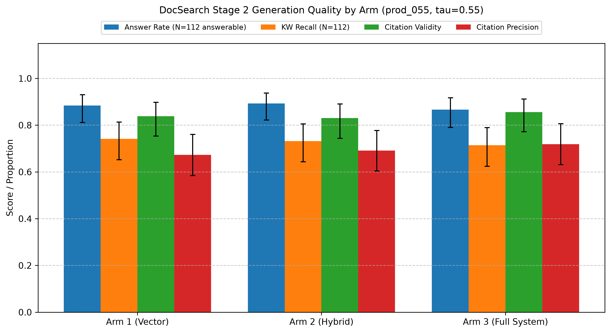
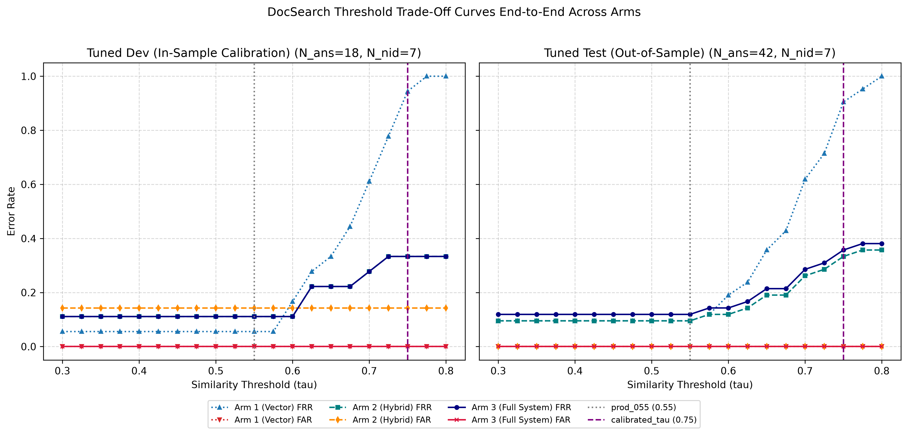
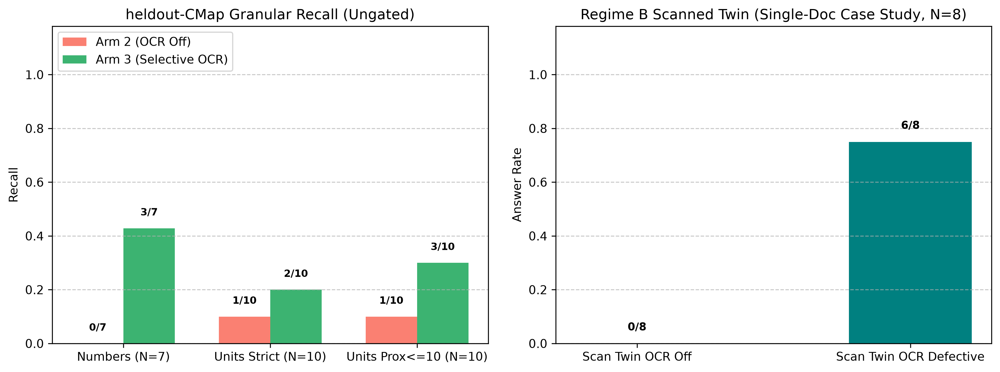

# DocSearch Evaluation Results (Stages 1 & 2)

**Document Version:** 2.0  
**Project:** B.Sc. Final Project — Persian RAG Document Search Service (DocSearch)  
**Evaluation Harness:** `eval/run_eval.py` & `eval/stage2.py`  
**Dataset Reference:** `eval/questions.json` (`eval-dataset-v2.2`, $N=138$ unique questions across 14 Regime A PDFs, plus 8 Regime B twin evaluations)  

---

## 1. Provenance & Methodological Guardrails

This document synthesizes the empirical evaluation of DocSearch across Stage 1 (retrieval-only ranking benchmark) and Stage 2 (end-to-end generation, abstention calibration, citation fidelity, and OCR generation impact).

### 1.1 Dual-Stage Provenance Header

All experiments were executed on locked, audited test benches with fixed model checkpoints, deterministic seeds, and isolated database schemas.

| Attribute | Stage 1 (Retrieval Ranking) | Stage 2 (End-to-End Generation & Abstention) |
|---|---|---|
| **Data Generation Git SHA** | `b3c9c12552e27349773fc63784f9e98cb61ff4e4` | `e7f4924554bc733979a72ddc6c7ff998a47d64ca` |
| **Report Rendering Git SHA** | `b3c9c12552e27349773fc63784f9e98cb61ff4e4` (rendered report marked `dirty: True` in Stage 1 artifact) | `506aa58708dde16154aa358bf6ce2455a834bbed` |
| **Git Working Tree Status** | pre-schema / unrecorded; report rendered with `dirty: True` | Clean on data generation (`git_dirty: false`) & report (`git_dirty: false`) |
| **Run Status** | pre-schema / unrecorded | `official` |
| **Reproducibility Archive** | Git tag `t19b-stage2-data` (`e7f4924554bc733979a72ddc6c7ff998a47d64ca`), GitHub Release asset `t19-eval-data.zip` (18 files, 975,651 bytes), SHA-256: `e8d7e4fc92c6e7e2f3965be9ad1f0e3e325ab030f9d31bd2db667df6209f2b95` | Git tag `t19b-stage2-data` (`e7f4924554bc733979a72ddc6c7ff998a47d64ca`), GitHub Release asset `t19-eval-data.zip` (18 files, 975,651 bytes), SHA-256: `e8d7e4fc92c6e7e2f3965be9ad1f0e3e325ab030f9d31bd2db667df6209f2b95` |
| **Dataset Tag** | `eval-dataset-v2.2` | `eval-dataset-v2.2` |
| **Questions SHA-256 (LF)** | `71d8573ce418c278a921638cdb9005acb48aa332bc7dae45a90d63bd213da62d` | `71d8573ce418c278a921638cdb9005acb48aa332bc7dae45a90d63bd213da62d` |
| **Embedding Model** | `BAAI/bge-m3` via Ollama (1024 dims, dense cosine) | `BAAI/bge-m3` via Ollama (1024 dims, dense cosine) |
| **Embedding Model Digest** | `7907646426070047a77226ac3e684fbbe8410524f7b4a74d02837e43f2146bab` | `7907646426070047a77226ac3e684fbbe8410524f7b4a74d02837e43f2146bab` |
| **Chat Generation Model** | N/A (retrieval only) | `gemini-3.5-flash-lite` |
| **Generation Temperature** | N/A | `0.0` (minimum temperature; non-deterministic across sessions as shown by `q015`, vs. production `0.1`) |
| **Retrieved Context Top-K** | Top-10 evaluated ($k \in \{1, 3, 5, 10\}$) | $Top-K = 6$ (fixed per `Rag:TopK`) |
| **System Prompt Version** | N/A | `src/DocSearch.Application/Prompts/system.v1.txt` |
| **System Prompt SHA-256** | N/A | `3d7c8fe28584d70e188198b9cc72f740f813b70fd6b910f82ff363e01fe8265f` |
| **Live Verification Agreement** | N/A | 36/36 (100%) pre-LLM gate agreement at $\tau = 0.55$ |
| **Cache Hit Rate (Stage 2)** | N/A | `1.2%` (5/430 queries; low rate due to unique per-collection chunk UUIDs) |
| **Failed Provider Count** | N/A | `0` (16 transient first-attempt failures recovered on retry) |

### 1.2 Evaluation Rigor & Methodological Guardrails

1. **Dataset Structure:** `eval/questions.json` (`eval-dataset-v2.2`) contains **138 unique questions across 14 Regime A PDFs**. The collection is split at the document level:
   - **`tuned` partition:** 74 questions across 11 documents (`aein-91.pdf`, `bedoon-factor.pdf`, `bein-almelali.pdf`, `bge-m3-paper.pdf`, `dastyar-amoozeshi.pdf`, `dastyar-pazhuheshi.pdf`, `hamayesh.pdf`, `kod-akhlaghi.pdf`, `rag-lewis-2020.pdf`, `shoraha-pazhuheshi.pdf`, `ziro-guide.pdf`). This partition is subdivided into `dev` ($N=25$: 18 answerable, 7 not-in-docs) and `test` ($N=49$: 42 answerable, 7 not-in-docs).
   - **`heldout` partition:** 64 questions across **3 PDFs**: `forsat-motaleati.pdf`, `shiveh-karamoozi.pdf`, and `tarh-dakheli.pdf` (52 answerable, 12 not-in-docs). Note that `aein-91.pdf` belongs to `tuned`, not `heldout`.
   - **Regime B:** 8 questions reusing 8 `bein-almelali.pdf` questions (3 dev, 5 test) evaluated against the scanned twin document `bein-almelali-scan.pdf`.
   - **Total Evaluations:** $138 \times 3 \text{ (Regime A)} + 8 \times 2 \text{ (Regime B)} = 430$ evaluations.
2. **Strict Data Leakage Prevention:** Calibration of similarity thresholds was strictly restricted to the in-sample `tuned|dev` partition ($N=25$). Any attempt to calculate thresholds on `heldout` or `test` partitions is rejected at runtime by automated programmatic assertion guards (`ANTI-LEAKAGE VIOLATION`).
3. **Exploratory Scope of Document-Cluster Bounds ($G=3$):** Because the held-out collection contains only $G=3$ documents (`forsat-motaleati.pdf`, `shiveh-karamoozi.pdf`, `tarh-dakheli.pdf`), asymptotic normal convergence of cluster-robust standard errors does not hold (which typically requires $G \ge 30$). Question-level Wilson confidence intervals treat observations as independent, ignoring document-level correlation, and are therefore narrower than true cluster-adjusted bounds. Paired non-parametric procedures (Paired Bootstrap 95% CIs with $B = 10,000$ resamples at seed 42 per ADR 0010 §5, and exact McNemar tests) serve as the primary inferential standard.
4. **Deterministic Offline Cache & Checkpoints:** Every LLM call in Stage 2 is uniquely keyed by:
   $$\text{CacheKey} = \text{SHA256}(\text{normalized\_query} \parallel \text{ordered\_chunk\_ids} \parallel \text{top\_k} \parallel \text{model} \parallel \text{temp} \parallel \text{prompt\_sha256})$$
   Retrieved chunk IDs are strictly preserved in rank order (never sorted alphabetically). Degraded responses are never cached.
5. **Denominator Invariance Across Operating Points:** For numeric and unit phrase recall, the denominator is established strictly from ground-truth annotations before threshold gating. Questions that are rejected (either pre-LLM by threshold gating or post-LLM by model refusal) count as explicit recall misses ($0$), never as omitted cases.

---

## 2. Pre-Registered vs. Post-Hoc Registry Table

To preserve scientific integrity and avoid selective reporting, all experimental endpoints and analytical investigations are classified according to their pre-registration status in Architecture Decision Records ADR 0010 and ADR 0011.

| Endpoint / Analysis | Target Cohort | Stage | Status | ADR Reference | Primary Metric / Test |
|---|---|---|---|---|---|
| **Primary Endpoint 1** | `heldout` answerable ($N=52$) | Stage 1 | Pre-Registered | ADR 0010 §3 & §5 | $\Delta\text{MRR}$ (Arm 2 Hybrid vs. Arm 1 Vector), Paired Bootstrap 95% CI |
| **Primary Endpoint 2** | `heldout-CMap` ($N=27$) | Stage 1 | Pre-Registered | ADR 0010 §3 & §5 | $\Delta\text{MRR}$ (Arm 3 Full System vs. Arm 2 OCR-Off), Paired Bootstrap 95% CI |
| **Primary Endpoint 2.1** | `heldout` answerable ($N=52$) | Stage 2 | Pre-Registered | ADR 0011 §5.1 | False Rejection Rate ($\text{FRR}$) across operating points (`prod_055` vs. `calibrated_tau`), 95% Wilson CI |
| **Primary Endpoint 2.2** | `heldout` not-in-docs ($N=12$) | Stage 2 | Pre-Registered | ADR 0011 §5.1 | False Acceptance Rate ($\text{FAR}$) across operating points (`prod_055` vs. `calibrated_tau`), 95% Wilson CI |
| **Secondary Endpoint (Granular Extraction)** | `heldout-CMap` ($N=27$) | Stage 2 | Pre-Registered | ADR 0011 §5.2 | Multi-digit Number Recall & Unit Phrase Recall under `ungated`, Descriptive & McNemar |
| **Regime B Scanned Twin Benchmark** | `bein-almelali-scan.pdf` ($N=8$) | Stages 1 & 2 | Pre-Registered | ADR 0010 §2.2 & ADR 0011 §2.2 | MRR & Answer Rate across OCR modes vs. Digital Reference |
| **Pure OCR Extractor Latency** | 37 sample pages | Stage 1 | Pre-Registered | ADR 0009 §5 | Wall-clock seconds per page across CMap & Scanned documents |
| **Vector-Component ROC-AUC** | Overall ($N=138$) & Heldout ($N=64$) | Stage 2 | Post-Hoc / Diagnostic | Section 5 of this report | ROC-AUC of `bestVectorScore` with Hanley-McNeil & bootstrap CIs |
| **FTS-Bypass Counterfactual Analysis** | `heldout` answerable ($N=52$) | Stage 2 | Post-Hoc / Diagnostic | Section 6 of this report | $\text{FRR}_{\text{LowSimilarity}}$ with vs. without Full-Text Search rescue |
| **Untouched Document Noise Floor** | Clean subset ($N=76$) | Stage 2 | Post-Hoc / Diagnostic | Section 7 of this report | Paired answer identity between Arm 2 and Arm 3 under identical context |
| **54-Judgment Manual Correctness Audit** | `heldout-CMap` ($N=27 \times 2$ arms, `ungated`) | Stage 2 | Post-Hoc / Diagnostic | Section 8.6 of this report | 4-label rubric (Correct, Partial, Wrong, Refused), Descriptive & McNemar |
| **Answerable FRR Decomposition** | Overall answerable ($N=112$) | Stage 2 | Post-Hoc / Diagnostic | Section 9 of this report | Rejection attribution (`LowSimilarity` vs. `RetMiss` vs. `Gold-in-top-6`) |
| **Persian Number-Word Sensitivity** | `heldout-CMap` ($N=27$) | Stage 2 | Post-Hoc / Diagnostic | Section 8 of this report | Impact of spelled-out Persian numbers on unit extraction |
| **Citation Precision & Page-Hit Audit** | Answered queries ($N=97\text{--}100$) | Stage 2 | Pre-Registered | ADR 0011 §7 | Citation Validity, Page-Hit Rate, Precision, and Recall |

---

## 3. Stage 1 Retrieval Benchmark Summary

Stage 1 established the baseline retrieval capability of DocSearch across three system configurations:
- **Arm 1 (Vector-Only, OCR-Off):** Dense embedding retrieval via Ollama `bge-m3` using pgvector HNSW cosine distance.
- **Arm 2 (Hybrid, OCR-Off):** Reciprocal Rank Fusion ($k_{\text{rrf}} = 60$) combining dense HNSW and PostgreSQL Full-Text Search using the `simple` text search dictionary with Persian character normalization and custom `ArticleKeys` weighting (ADR 0005).
- **Arm 3 (Full System: Hybrid + Selective OCR):** Reciprocal Rank Fusion operating over documents processed by the selective OCR sidecar (correcting defective Persian CID/ToUnicode font tables).

### 3.1 Primary Endpoints 1 & 2 Outcomes

| Cohort | Arm 1 MRR | Arm 2 MRR | Arm 3 MRR | $\Delta\text{MRR}$ (Arm 2 vs 1) [95% CI] | $\Delta\text{MRR}$ (Arm 3 vs 2) [95% CI] | Primary Conclusion |
|---|---|---|---|---|---|---|
| **Overall** ($N=112$) | **0.8500** | 0.7837 | 0.7822 | -0.0663 [-0.1214, -0.0124] | -0.0014 [-0.0351, 0.0327] | Vector-only superior on overall ranking |
| **Primary Endpoint 1 (`heldout_all`, $N=52$)** | **0.8638** | 0.7919 | 0.7903 | -0.0719 [-0.1501, +0.0032] | -0.0016 [-0.0660, +0.0609] | Hybrid does not outperform dense search |
| **Primary Endpoint 2 (`heldout-CMap`, $N=27$)** | **0.8951** | 0.7883 | 0.7852 | -0.1068 [-0.2148, -0.0093] | -0.0031 [-0.1272, +0.1154] | Macro-MRR retrieval parity across OCR modes |
| `heldout_test` ($N=39$) | **0.8739** | 0.7986 | 0.7952 | -0.0754 [-0.1641, +0.0058] | -0.0034 [-0.0701, +0.0598] | Consistent with heldout-all |
| `tuned_test` ($N=42$) | **0.8340** | 0.7409 | 0.7504 | -0.0931 [-0.1865, +0.0003] | +0.0095 [-0.0266, +0.0452] | Mild OCR retrieval uplift on tuned test |
| `tuned_dev` ($N=18$) | 0.8472 | **0.8598** | 0.8333 | +0.0126 [-0.1111, +0.1468] | -0.0265 [-0.0913, +0.0132] | In-sample calibration partition |

### 3.2 Document Heterogeneity on CMap Cohort

While aggregate macro-MRR on `heldout-CMap` shows parity ($\Delta\text{MRR} = -0.0031$), disaggregation by document reveals structural heterogeneity:
- **`forsat-motaleati.pdf` ($N=12$):** Arm 2 MRR was 0.6694, while Arm 3 achieved **0.7847** ($\Delta\text{MRR} = +0.1153$ [95% CI: $+0.0083, +0.2500$]). Here, defective font mappings harmed lexical retrieval, and OCR restoration produced statistically significant ranking recovery.
- **`tarh-dakheli.pdf` ($N=15$):** Arm 2 MRR was 0.8833, while Arm 3 was 0.7856 ($\Delta\text{MRR} = -0.0978$ [95% CI: $-0.2767, +0.0889$]). In this document, layout section titles allowed coarse chunk retrieval even with corrupted body glyphs, whereas minor OCR character noise slightly shifted rank ordering.

### 3.3 Implementation Observation: RRF Weighting

In `src/DocSearch.Infrastructure/Rag/RankFusion.cs`, fusion is implemented using equal reciprocal rank weights ($w_{\text{vec}} = 1.0, w_{\text{fts}} = 1.0, k = 60$), whereas ADR 0005 §2.4 originally proposed unequal weights ($w_{\text{vec}} = 0.7, w_{\text{fts}} = 0.3$). This weight drift between specification and implementation was logged as an architectural note; per Golden Rule 1, C# code was kept frozen during evaluation.

### 3.4 Similarity Calibration Plateaus on Dev

Per-arm grid sweeps ($0.30 \le \tau \le 0.80$, step 0.025) on the in-sample development partition ($N=25$: 18 answerable, 7 not-in-docs) locked the following operating points:
- **Arm 1 (Vector):** Plateau $[0.675, 0.700]$, locked $\tau^* = 0.700$ (best balanced error: $0.2937$).
- **Arm 2 (Hybrid):** Plateau $[0.700, 0.800]$, locked $\tau^* = 0.750$ (best balanced error: $0.3690$).
- **Arm 3 (Full System):** Plateau $[0.700, 0.800]$, locked $\tau^* = 0.750$ (best balanced error: $0.2976$).

### 3.5 Pure OCR Timing Benchmark (Extractor Sidecar)

Benchmarked on the standalone FastAPI extractor sidecar (`tesseract-ocr-fas`, 300 DPI, PSM 6):
- **Overall Pure OCR:** **$4.131\text{ s/page}$** (37 pages in 152.84 s).
- **Regime A (CMap Defective Documents):** **$3.608\text{ s/page}$** (29 pages in 104.63 s).
- **Regime B (Scanned Document):** **$6.026\text{ s/page}$** (8 pages in 48.21 s).

### 3.6 Regime B Scanned Twin Retrieval

Evaluating the 8 twin questions on `bein-almelali-scan.pdf`:
- **Scan Twin with OCR-Off:** $\text{MRR} = 0.000$, $\text{Recall@1} = 0.0\%$, $\text{Recall@5} = 0.0\%$ (image-only PDF; 0 text extracted).
- **Scan Twin with Selective OCR:** $\text{MRR} = \mathbf{0.875}$, $\text{Recall@1} = 75.0\%$, $\text{Recall@5} = 100.0\%$.
- **Digital Reference (Clean PDF):** $\text{MRR} = 0.9167$, $\text{Recall@1} = 87.5\%$, $\text{Recall@5} = 100.0\%$.
- Selective OCR achieved an MRR within 0.0417 of the clean digital reference ($\Delta\text{MRR} = -0.0417$).

---

## 4. Stage 2 Offline Simulation Live Cross-Check

Before conducting the full Stage 2 offline threshold simulation, a live validation experiment was conducted against the running DocSearch API to verify that offline threshold filtering is consistent with live execution at $\tau = 0.55$. Higher thresholds ($\tau^* = 0.70 / 0.75$) were evaluated offline only.

A sample of 36 question-arm executions was evaluated:
- **Arm 1 (Vector-Only, `Rag__UseHybrid=false`, $\tau=0.55$):** 18 questions.
  - Pre-LLM gate agreement: **18 / 18 (100.0%)**.
  - Post-LLM outcome agreement: **17 / 18 (94.4%)**. Exactly 1 question (`q015`) differed at temperature 0.0, illustrating minor generation variability across sessions.
- **Hybrid Arms (`Rag__UseHybrid=true`, $\tau=0.55$):** 18 questions across Arm 2, Arm 3, and Regime B scan-off.
  - Pre-LLM gate agreement: **18 / 18 (100.0%)**.
  - Post-LLM outcome agreement: **18 / 18 (100.0%)**.
- **Combined Pre-LLM Gate Agreement:** **36 / 36 (100.0%)**.

*(Note: Per-stratum reporting was added to the test harness in Commit A after this live validation run was completed).*

---

## 5. Stage 2 Primary Endpoints: Negative Result on Calibrated Tau & Vector ROC-AUC

Stage 2 evaluated end-to-end question answering across three operating points:
1. **`prod_055` (Production Baseline):** Threshold locked at $\tau = 0.55$ per `appsettings.json`.
2. **`calibrated_tau` (In-Sample Calibrated):** Threshold locked at the dev plateau centers ($\tau^* = 0.70$ for Arm 1, $\tau^* = 0.75$ for Arms 2 & 3).
3. **`ungated` ($\tau = 0.00$):** Threshold gating disabled; every query passes directly to generation.

### 5.1 Primary Endpoints 2.1 & 2.2 Results (Held-out Generalization & Partition Breakdown)

#### Held-out Generalization Partition ($N=64$: 52 Answerable, 12 Not-in-Docs)

| Arm | Operating Point | Held-out Answerable FRR ($N=52$) [95% CI] | LowSimilarity FRR | ModelRefusal FRR | Held-out NID FAR ($N=12$) [95% CI] |
|---|---|---|---|---|---|
| **Arm 1 (Vector)** | `ungated` | 13.5% [6.7%, 25.3%] | 0.0% | 13.5% | 0.0% [0.0%, 24.2%] |
| **Arm 1 (Vector)** | `prod_055` | **15.4%** [8.0%, 27.5%] | 1.9% | 13.5% | **0.0%** [0.0%, 24.2%] |
| **Arm 1 (Vector)** | `calibrated_tau` ($\tau^*=0.70$) | **76.9%** [63.9%, 86.3%] | 73.1% | 3.8% | **0.0%** [0.0%, 24.2%] |
| **Arm 2 (Hybrid)** | `ungated` | 9.6% [4.2%, 20.6%] | 0.0% | 9.6% | 0.0% [0.0%, 24.2%] |
| **Arm 2 (Hybrid)** | `prod_055` | **11.5%** [5.4%, 23.0%] | 1.9% | 9.6% | **0.0%** [0.0%, 24.2%] |
| **Arm 2 (Hybrid)** | `calibrated_tau` ($\tau^*=0.75$) | **40.4%** [28.2%, 53.9%] | 34.6% | 5.8% | **0.0%** [0.0%, 24.2%] |
| **Arm 3 (Full System)** | `ungated` | 13.5% [6.7%, 25.3%] | 0.0% | 13.5% | 0.0% [0.0%, 24.2%] |
| **Arm 3 (Full System)** | `prod_055` | **15.4%** [8.0%, 27.5%] | 3.8% | 11.5% | **0.0%** [0.0%, 24.2%] |
| **Arm 3 (Full System)** | `calibrated_tau` ($\tau^*=0.75$) | **40.4%** [28.2%, 53.9%] | 34.6% | 5.8% | **0.0%** [0.0%, 24.2%] |

#### Tuned Dev Partition (In-Sample Calibration, $N=25$: 18 Answerable, 7 Not-in-Docs)

| Arm | Operating Point | Dev Answerable FRR ($N=18$) [95% CI] | LowSimilarity FRR | ModelRefusal FRR | Dev NID FAR ($N=7$) [95% CI] |
|---|---|---|---|---|---|
| **Arm 1 (Vector)** | `ungated` | 5.6% [1.0%, 25.8%] | 0.0% | 5.6% | 0.0% [0.0%, 35.4%] |
| **Arm 1 (Vector)** | `prod_055` | 5.6% [1.0%, 25.8%] | 0.0% | 5.6% | 0.0% [0.0%, 35.4%] |
| **Arm 1 (Vector)** | `calibrated_tau` ($\tau^*=0.70$) | 61.1% [38.6%, 79.7%] | 61.1% | 0.0% | 0.0% [0.0%, 35.4%] |
| **Arm 2 (Hybrid)** | `ungated` | 11.1% [3.1%, 32.8%] | 0.0% | 11.1% | 14.3% [2.6%, 51.3%] (`q043`) |
| **Arm 2 (Hybrid)** | `prod_055` | 11.1% [3.1%, 32.8%] | 0.0% | 11.1% | 14.3% [2.6%, 51.3%] (`q043`) |
| **Arm 2 (Hybrid)** | `calibrated_tau` ($\tau^*=0.75$) | 33.3% [16.3%, 56.3%] | 22.2% | 11.1% | 14.3% [2.6%, 51.3%] (`q043`) |
| **Arm 3 (Full System)** | `ungated` | 11.1% [3.1%, 32.8%] | 0.0% | 11.1% | 0.0% [0.0%, 35.4%] |
| **Arm 3 (Full System)** | `prod_055` | 11.1% [3.1%, 32.8%] | 0.0% | 11.1% | 0.0% [0.0%, 35.4%] |
| **Arm 3 (Full System)** | `calibrated_tau` ($\tau^*=0.75$) | 33.3% [16.3%, 56.3%] | 22.2% | 11.1% | 0.0% [0.0%, 35.4%] |

#### Tuned Test Partition (Out-of-Sample Known Documents, $N=49$: 42 Answerable, 7 Not-in-Docs)

| Arm | Operating Point | Test Answerable FRR ($N=42$) [95% CI] | LowSimilarity FRR | ModelRefusal FRR | Test NID FAR ($N=7$) [95% CI] |
|---|---|---|---|---|---|
| **Arm 1 (Vector)** | `ungated` | 9.5% [3.8%, 22.1%] | 0.0% | 9.5% | 0.0% [0.0%, 35.4%] |
| **Arm 1 (Vector)** | `prod_055` | 9.5% [3.8%, 22.1%] | 0.0% | 9.5% | 0.0% [0.0%, 35.4%] |
| **Arm 1 (Vector)** | `calibrated_tau` ($\tau^*=0.70$) | 61.9% [46.8%, 75.0%] | 61.9% | 0.0% | 0.0% [0.0%, 35.4%] |
| **Arm 2 (Hybrid)** | `ungated` | 9.5% [3.8%, 22.1%] | 0.0% | 9.5% | 0.0% [0.0%, 35.4%] |
| **Arm 2 (Hybrid)** | `prod_055` | 9.5% [3.8%, 22.1%] | 0.0% | 9.5% | 0.0% [0.0%, 35.4%] |
| **Arm 2 (Hybrid)** | `calibrated_tau` ($\tau^*=0.75$) | 33.3% [21.0%, 48.5%] | 28.6% | 4.8% | 0.0% [0.0%, 35.4%] |
| **Arm 3 (Full System)** | `ungated` | 11.9% [5.2%, 25.0%] | 0.0% | 11.9% | 0.0% [0.0%, 35.4%] |
| **Arm 3 (Full System)** | `prod_055` | 11.9% [5.2%, 25.0%] | 0.0% | 11.9% | 0.0% [0.0%, 35.4%] |
| **Arm 3 (Full System)** | `calibrated_tau` ($\tau^*=0.75$) | 35.7% [23.0%, 50.8%] | 28.6% | 7.1% | 0.0% [0.0%, 35.4%] |

#### Overall Not-in-Docs (NID) False Acceptance Rate Summary ($N=26$)

False Acceptance Rate (FAR) is invariant across operating points: Arm 1 and Arm 3 achieved **0.0%** (0/26, 95% Wilson CI: [0.0%, 12.9%]), while Arm 2 achieved **3.8%** (1/26, 95% Wilson CI: [0.7%, 18.9%]; sole template-based false acceptance on `q043` in dev). The table below details the refusal attribution (`LowSimilarity` vs. `ModelRefusal`) across operating points:

| Arm | Operating Point | NID Evaluated | False Acceptances | FAR (%) [95% CI] | Refusal Attribution (LowSim / ModRef) |
|---|---|---|---|---|---|
| **Arm 1 (Vector-Only)** | `ungated` | 26 | 0 | **0.0%** [0.0%, 12.9%] | 0 LowSim / 26 ModRef |
| **Arm 1 (Vector-Only)** | `prod_055` | 26 | 0 | **0.0%** [0.0%, 12.9%] | 4 LowSim / 22 ModRef |
| **Arm 1 (Vector-Only)** | `calibrated_tau` ($\tau^*=0.70$) | 26 | 0 | **0.0%** [0.0%, 12.9%] | 25 LowSim / 1 ModRef |
| **Arm 2 (Hybrid, OCR-Off)** | `ungated` | 26 | 1 | **3.8%** [0.7%, 18.9%] | 0 LowSim / 25 ModRef (1 FA on `q043`) |
| **Arm 2 (Hybrid, OCR-Off)** | `prod_055` | 26 | 1 | **3.8%** [0.7%, 18.9%] | 3 LowSim / 22 ModRef (1 FA on `q043`) |
| **Arm 2 (Hybrid, OCR-Off)** | `calibrated_tau` ($\tau^*=0.75$) | 26 | 1 | **3.8%** [0.7%, 18.9%] | 13 LowSim / 12 ModRef (1 FA on `q043`) |
| **Arm 3 (Full System)** | `ungated` | 26 | 0 | **0.0%** [0.0%, 12.9%] | 0 LowSim / 26 ModRef |
| **Arm 3 (Full System)** | `prod_055` | 26 | 0 | **0.0%** [0.0%, 12.9%] | 2 LowSim / 24 ModRef |
| **Arm 3 (Full System)** | `calibrated_tau` ($\tau^*=0.75$) | 26 | 0 | **0.0%** [0.0%, 12.9%] | 12 LowSim / 14 ModRef |

### 5.2 Floor Limitation on Endpoint 2.2

Primary Endpoint 2.2 (Held-out NID FAR) is **floor-limited**: all configurations achieved **0 / 12 (0.0%)** false acceptances on the held-out partition. With $N=12$, the 95% Wilson score upper bound is $24.2\%$. Consequently, Endpoint 2.2 cannot statistically separate the operating points.

### 5.3 Explicit Negative Result: Rejection of Calibrated Tau

A key empirical finding of this thesis is that **in-sample calibration of similarity thresholds fails out-of-sample and is rejected**:
- On the 52 held-out answerable benchmark questions, raising the threshold to $\tau^* = 0.70 / 0.75$ increased FRR to **76.9%** in Arm 1 and **40.4%** in Arms 2 and 3.
- Raising the threshold provided zero reduction in out-of-sample false acceptances (FAR remained 0.0%).
- Therefore, `calibrated_tau` is **not recommended** for production deployment.

### 5.4 Comparison of `prod_055` vs. `ungated`

Comparing `prod_055` ($\tau = 0.55$) against `ungated` ($\tau = 0.00$):
- Across the entire benchmark, `ModelRefusal` alone rejected 22–24 of 26 not-in-docs questions overall, and 11–12 of 12 held-out NID questions.
- Under `prod_055`, pre-LLM threshold gating added 1 to 2 false rejections on answerable questions while preventing 0 false acceptances on this benchmark.
- Retaining $\tau = 0.55$ as the default is justified operationally as a safeguard against compute cost and latency on completely off-topic queries, rather than as a demonstrated precision filter.

### 5.5 Vector-Component ROC-AUC Analysis (Post-Hoc)

Because the hybrid gate allows FTS matches to bypass similarity gating ($\text{score} \ge \tau \lor \text{hasFtsHit}$), the discriminative power of `bestVectorScore` alone was evaluated via ROC-AUC:

| Partition | Arm 1 / 2 Cosine AUC [Hanley-McNeil 95% CI] | Bootstrap 95% CI | Arm 3 Cosine AUC [Hanley-McNeil 95% CI] | Bootstrap 95% CI |
|---|---|---|---|---|
| **Overall** ($N_{\text{ans}}=112, N_{\text{nid}}=26$) | **0.7424** [0.649, 0.836] | [0.640, 0.837] | **0.7208** [0.623, 0.818] | [0.612, 0.821] |
| **Held-out** ($N_{\text{ans}}=52, N_{\text{nid}}=12$) | **0.6250** [0.459, 0.791] | [0.449, 0.787] | **0.5641** [0.388, 0.740] | [0.375, 0.745] |

On held-out documents, the confidence intervals span from below 0.50 to nearly 0.80. The apparent drop in AUC from overall to held-out is not statistically significant given the small sample size ($N_{\text{nid}}=12$).

### 5.6 Template-Based False Acceptance Analysis (`q043`)

Across all not-in-docs queries ($N=26$ overall: 7 in dev, 7 in test, 12 in heldout), exactly one template-based acceptance occurred:
- **Arm 1 (Vector):** 0 / 26 FAR
- **Arm 2 (Hybrid):** 1 / 26 FAR (1 / 7 in `tuned|dev`)
- **Arm 3 (Full System):** 0 / 26 FAR

**Context of `q043`:** The query asks for a base lecturer's (`مربی پایه`) hourly teaching rate in Toman. In Arm 2, hybrid retrieval returned a related section from page 3 of `dastyar-amoozeshi.pdf` specifying the maximum practical-course remuneration for doctoral teaching assistants (equated to a base-level-1 lecturer's rate) with `bestVectorScore = 0.5793` and `hasFtsHit = true`. Because `hasFtsHit = true`, this query also bypasses `tau = 0.75` in the hybrid gate. The model stated that the exact monetary amount was not specified in the document (a soft refusal), while citing the practical-course remuneration clause confirmed present on page 3.

---

## 6. Hybrid vs. Vector Retrieval & FTS-Bypass Counterfactual

### 6.1 End-to-End Answer Quality Comparison

Under production gating ($\tau = 0.55$), comparing Arm 1 (Vector) and Arm 2 (Hybrid):
- **Overall Answer Rate ($N=112$):** Arm 1 = 88.4% (99/112) vs. Arm 2 = 89.3% (100/112). Discordant pairs: $A_{\text{only}} = 4, B_{\text{only}} = 5$, exact McNemar **$p = 1.000$**.
- **Overall Keyword Recall ($N=112$):** Arm 1 = 74.1% (83/112) vs. Arm 2 = 73.2% (82/112). Discordant pairs: $A_{\text{only}} = 5, B_{\text{only}} = 4$, exact McNemar **$p = 1.000$**.
- **Held-out Answer Rate ($N=52$):** Discordant pairs: $A_{\text{only}} = 2, B_{\text{only}} = 4$, exact McNemar **$p = 0.6875$**.
- **Held-out Keyword Recall ($N=52$):** Discordant pairs: $A_{\text{only}} = 2, B_{\text{only}} = 3$, exact McNemar **$p = 1.000$**.
- **Arm 1 vs. Arm 3 on Held-out ($N=52$):** Exact McNemar **$p = 1.000$** for both answer rate and keyword recall.

Hybrid search with equal RRF weights (1.0/1.0) showed a statistically significant Stage 1 ranking drop (overall ΔMRR = -0.0663 [-0.1214, -0.0124]; heldout-CMap ΔMRR = -0.1068 [-0.2148, -0.0093]), yet produced no statistically distinguishable end-to-end degradation (p = 1.000) because the LLM reads all top-6 chunks. Keyword and article-key support is retained as the architectural design rationale per ADR 0005.

### 6.2 FTS-Bypass Counterfactual Analysis (Post-Hoc)

In the hybrid gate, a query passes to generation if $\text{score} \ge \tau \lor \text{hasFtsHit}$. To isolate the effect of this gate design rule at high thresholds ($\tau = 0.75$), a counterfactual was evaluated where FTS bypass was disabled (`hasFtsHit=False`):
- **With FTS Bypass (Actual Hybrid Gate):** Held-out LowSimilarity FRR = **34.6%** (18/52).
- **Without FTS Bypass (Pure Cosine Counterfactual):** Held-out LowSimilarity FRR = **98.1%** (51/52).
- Across the overall collection, LowSimilarity FRR rises from 30.4% to 94.6% (Arm 2) / 93.8% (Arm 3).

This counterfactual demonstrates that the difference in FRR between Arm 1 (76.9% at $\tau^* = 0.70$) and Arms 2–3 (40.4% at $\tau^* = 0.75$) is driven by the FTS bypass rule rather than higher cosine similarity.

---

## 7. Baseline Noise Floor (Null Experiment)

To assess baseline model variability at temperature 0.0, a null experiment was conducted on the **8 non-OCR PDFs** (`aein-91.pdf`, `bein-almelali.pdf`, `bge-m3-paper.pdf`, `dastyar-amoozeshi.pdf`, `rag-lewis-2020.pdf`, `shiveh-karamoozi.pdf`, `shoraha-pazhuheshi.pdf`, `ziro-guide.pdf`):
- Across these 8 documents (76 answerable questions), ingestion text for Arm 2 and Arm 3 is identical.
- **Answer Status Disagreements:** **0 / 76** (both configurations answered 69/76).
- **Keyword Hit Disagreements:** **0 / 76** (both configurations achieved 61/76 keyword hits, exact McNemar $p = 1.000$).
- When expanding to all pages tagged `text_layer_defect == False` ($N=83$, including clean pages from CMap documents):
  - Answer status disagreements: **0 / 83**.
  - Keyword hit disagreements: **2 / 83** (`q090` and `q094` on CMap PDFs, exact McNemar $p = 0.500$).

This confirms that baseline generation noise at temperature 0.0 is near-zero under identical context. Differences between Arm 2 and Arm 3 on defective documents reflect genuine text layer differences, though aggregate differences across the full collection remain non-significant ($p = 0.375$ for answer status, $p = 0.8036$ for keyword hits).

---

## 8. Stage 2 Secondary Endpoint: Granular Extraction on `heldout-CMap`

The pre-registered secondary endpoint (ADR 0011 §5.2) evaluates granular extraction on the two held-out documents with defective CMap text layers: `tarh-dakheli.pdf` and `forsat-motaleati.pdf` ($N=27$ answerable questions, 0 not-in-docs). Evaluated under the **`ungated`** operating point:

### 8.1 Secondary Endpoint Metrics

| Metric | Arm 2 (OCR Off) | Arm 3 (Selective OCR) | Delta (pp) | Exact McNemar $p$ (Descriptive) |
|---|---|---|---|---|
| **Multi-digit Numbers ($N=7$)** | **0 / 7 (0.0%)** [0.0%, 35.4%] | **3 / 7 (42.9%)** [15.8%, 75.0%] | **+42.9 pp** | $p = 0.250$ |
| **Unit Phrases Strict ($N=10$)** | **1 / 10 (10.0%)** [1.8%, 40.4%] | **2 / 10 (20.0%)** [5.7%, 51.0%] | **+10.0 pp** | $p = 1.000$ |
| **Unit Phrases Proximity $\le 10$ ($N=10$)** | **1 / 10 (10.0%)** [1.8%, 40.4%] | **3 / 10 (30.0%)** [10.8%, 60.3%] | **+20.0 pp** | $p = 0.625$ |

*(Note: Cluster bootstrap CI is degenerate with $G=2$ documents; exact Wilson score CIs are reported).*

### 8.2 Qualitative Finding: Corrupted Text and Confident Incorrect Numbers

A manual audit of the 7 numeric questions on `heldout-CMap` revealed that in Arm 2 (OCR Off), the model answered 5 of 7 questions and got **0 of 7 correct**:
- In all 5 answered cases (**`q079`, `q080`, `q081`, `q096`, `q099`**), Arm 2 output confirmed corrupted numbers derived from broken ToUnicode mappings, presenting them without qualification.
- Outside the $N=7$ subset, single-digit corruptions occurred in Arm 2 on `q097` and `q102`.
- **Spelled-Out-Number Metric Blind Spot:** Persian numbers written as words fall outside the digit-regex denominator ($N_{\text{num}}=7$), as seen in `q082` and `q094`, where textual descriptions or spelled-out quantities bypassed numeric regex extraction.
- Arm 3 (Selective OCR) reduced these errors: it recovered `q079`, `q096`, and `q099` fully; on `q080`, it recovered the grant cap while slipping on a percentage digit (20% vs. 30%); on `q081`, it abstained on an unreadable ceiling figure; and on `q087` and `q101`, it experienced model refusal.
- Formatting note: on `q079`, the output formatted the unit as `/-` which failed strict string matching despite recovering the exact numbers.

### 8.3 Document Heterogeneity on CMap Documents

- **`forsat-motaleati.pdf` ($N=12$):** Arm 3 improved keyword recall (6/12 vs. 5/12), numbers (2/3 vs. 0/3), unit strict (2/6 vs. 1/6), and unit proximity (2/6 vs. 1/6).
- **`tarh-dakheli.pdf` ($N=15$):** Arm 3 improved numbers (1/4 vs. 0/4) and unit proximity (1/4 vs. 0/4), while keyword recall was lower (9/15 vs. 11/15), consistent with the Stage 1 retrieval findings.

### 8.4 Post-Hoc Persian Number-Word Sensitivity Audit

Evaluating Persian spelled-out number words:
- In Arm 2, spelled-out normalization produced no change (1/10 strict, 1/10 prox; `q102` retained a corrupted digit).
- In Arm 3, naive matching flagged `q103` as a hit; however, manual review determined this was a false positive (Arm 3 stated "one or two" articles instead of JCR Q1/Q2 requirements).
- Audited Arm 3 recall remains **2 / 10** (strict) and **3 / 10** (proximity).

### 8.5 Contextual Comparison Across Cohorts (ungated operating point)

| Cohort | Number Recall (Arm 2 vs. 3) | Unit Strict (Arm 2 vs. 3) | Unit Prox (Arm 2 vs. 3) | Keyword Recall (Arm 2 vs. 3) |
|---|---|---|---|---|
| `heldout-CMap` ($N=27, G=2$) | 0/7 (0.0%) vs. 3/7 (42.9%) | 1/10 (10.0%) vs. 2/10 (20.0%) | 1/10 (10.0%) vs. 3/10 (30.0%) | 16/27 (59.3%) vs. 15/27 (55.6%) |
| `primary_cmap` ($N=36, G=6$) | 0/10 (0.0%) vs. 4/10 (40.0%) | 1/14 (7.1%) vs. 3/14 (21.4%) | 1/14 (7.1%) vs. 4/14 (28.6%) | 22/36 (61.1%) vs. 20/36 (55.6%) |
| `overall` ($N=112$) | 25/41 (61.0%) vs. 30/41 (73.2%) | 17/36 (47.2%) vs. 17/36 (47.2%) | 19/36 (52.8%) vs. 22/36 (61.1%) | 83/112 (74.1%) vs. 81/112 (72.3%) |

### 8.6 54-Judgment Manual Correctness Audit on `heldout-CMap` (Post-Hoc)

To assess factual truthfulness beyond regex string matching, a manual judgment audit was conducted across all 27 answerable questions on `heldout-CMap` under `ungated` execution for Arm 2 and Arm 3 ($N = 27 \times 2 = 54$ judgments). Responses were classified under a mutually exclusive 4-label rubric:
1. **Correct:** The generated response is completely accurate and answers the query according to ground-truth document facts.
2. **Partial (no error):** The response provides accurate partial information (e.g. covers partial eligibility clauses) without asserting factual or numeric errors.
3. **Wrong (factual/numeric error):** The response asserts factually incorrect information or corrupted numerals.
4. **Refused:** The model explicitly refused to answer (e.g. stating that the document does not contain the answer).

| Category | Arm 2 (OCR Off) | Arm 3 (Selective OCR) | Delta (pp) | Notes / Error Attribution |
|---|---|---|---|---|
| **Correct** | **16 / 27 (59.3%)** | **15 / 27 (55.6%)** | **-3.7 pp** | Arm 2: 11/15 `tarh`, 5/12 `forsat`; Arm 3: 9/15 `tarh`, 6/12 `forsat` |
| **Partial (no error)** | **1 / 27 (3.7%)** | **3 / 27 (11.1%)** | **+7.4 pp** | Arm 2: `q098`; Arm 3: `q081, q094, q098` |
| **Wrong (factual/numeric error)** | **7 / 27 (25.9%)** | **4 / 27 (14.8%)** | **-11.1 pp** | Paired discordant 6 vs 3, exact McNemar $p = 0.508$ (descriptive only) |
| **Refused** | **3 / 27 (11.1%)** | **5 / 27 (18.5%)** | **+7.4 pp** | Arm 2: `q087, q100, q101`; Arm 3: `q087, q088, q100, q101, q102` |
| **CMap Digit-Corruption Subset** | **7 / 27 (25.9%)** | **1 / 27 (3.7%)** | **-22.2 pp** | Arm 2: 7/7 corrupted numerals (`q079, q080, q081, q096, q097, q099, q102`); Arm 3: 1 slip (`q080` 20% vs 30%) |

#### Qualitative Error Attribution
- **Arm 2 Font Corruption Failures:** In Arm 2 (OCR Off), all 7 wrong responses (`q079, q080, q081, q096, q097, q099, q102`) were caused directly by broken CMap/ToUnicode mappings in the ingested text. In every case, the model presented corrupted numbers (e.g. inverted digits or mismatched ASCII values) with high confidence.
- **Arm 3 Selective OCR Recovery:** Selective OCR eliminated 6 of the 7 corrupted numeral errors:
  - `q079`, `q096`, `q097`, and `q099` (4 items) were converted from wrong numbers in Arm 2 into fully correct answers in Arm 3.
  - On `q080`, the monetary ceiling (`350,000,000` Rials) was recovered correctly, with an OCR/generation slip on the accompanying percentage (`20%` vs. `30%`).
  - On `q081`, Arm 3 provided a partial answer (correct 2-year window and `10,000,000`-Rial personnel cap) while transparently noting the total ceiling was illegible.
  - On `q102`, Arm 3 refused rather than asserting a corrupted deadline digit (`8` vs. `9` months in Arm 2).
- **Non-Digit Errors & Regressions in Arm 3:** The remaining 3 wrong answers in Arm 3 (`q082, q090, q103`) were non-digit errors: `q082` (`tarh-dakheli.pdf`) stated "two" instead of "three" maximum grants during Assistant Professor rank (spelled-out numeral error); `q090` attributed profit-share approval to the "University President" instead of the "University Board of Directors" (`هیأت رئیسه`); and `q103` stated "one or two ISI articles" instead of "a joint project or 2 JCR Q1/Q2 articles". Arm 3 also added 1 refusal (`q088`) and 1 partial omission (`q094`, omitting the domestic sabbatical cap).
- **Minor Artifacts & `kw_hit` Caveat:** In Arm 2, `q082` appended a stray refusal sentence after stating the correct facts and `q089` had a corrupted clause reference while stating the correct 2-year rule; in Arm 3, `q083` contained a minor OCR token artifact without altering meaning. Crucially, while `kw_hit` can produce false positives on numeric questions (observed on `tuned` CMap items `q014` and `q022`), on `heldout-CMap` itself the Arm 3 vs. Arm 2 contrast reflects a genuine trade-off between eliminating 6/7 CMap digit corruptions and introducing non-digit OCR/retrieval errors.
- **Statistical Assessment:** Paired comparison yields 6 questions wrong only in Arm 2 vs. 3 wrong only in Arm 3 (exact two-sided McNemar $p = 0.508$). Consequently, while the reduction in numeral hallucination is prominent (7 down to 1), overall correctness differences remain descriptive on this sample size.

---

## 9. Error Analysis, Question Types, Citations, Latency & Reliability

### 9.1 Answerable FRR Decomposition at `prod_055` ($N=112$)

Classifying all answerable false rejections using the `text_layer_defect` flag and Stage 1 rank proxy:
- **Arm 1 ($Tot=13$):** `LowSimilarity = 1` (`q078`), `RetMiss = 3` (`q015, q034, q056`), `Gold-in-top-6 (defect=True) = 6` (`q039, q082, q083, q087, q100, q101`), `Gold-in-top-6 (defect=False) = 3` (`q058, q073, q098`).
- **Arm 2 ($Tot=12$):** `LowSimilarity = 1` (`q078`), `RetMiss = 6` (`q028, q034, q039, q056, q074, q125`), `Gold-in-top-6 (defect=True) = 3` (`q087, q100, q101`), `Gold-in-top-6 (defect=False) = 2` (`q024, q058`).
- **Arm 3 ($Tot=15$):** `LowSimilarity = 2` (`q078, q088`), `RetMiss = 5` (`q034, q039, q056, q074, q125`), `Gold-in-top-6 (defect=True) = 6` (`q014, q022, q087, q100, q101, q102`), `Gold-in-top-6 (defect=False) = 2` (`q024, q058`).

**Analytical Observations:**
- `q039` (`ziro-guide.pdf` screenshot) has `defect=True`, while `q098` (`forsat-motaleati.pdf`) has `defect=False`, explaining minor differences from document-level counts.
- `q058` (`bge-m3-paper.pdf`, p. 6) was refused across all three arms despite ranks 2–4 in Stage 1; hypothesized to result from dense tabular formatting across chunk boundaries.
- `q014` and `q022` were answered in Arm 2 but refused in Arm 3. Manual review confirmed that Arm 2 answered both with incorrect numbers; thus, Arm 3's refusal represents an abstention rather than regression from a clean answer.

### 9.2 Keyword Audit & `english` Question Type

Of 17 answered items in Arm 3 that missed keyword recall:
- **6 of 17 (35.3%)** are metric artifacts: 5 questions in the `english` category (`q050, q051, q052, q054, q055`) where the model answered accurately in Persian without using English strings, and `q111` (decimal formatting difference). Across the 12 `english` questions, all arms achieved 10/12 answer rate but only 5/12 keyword hits.
- The remaining misses reflect factual errors (`q082`, `q090`, `q103`) or inline partial refusals (`q098`).
- **Persian-Only Keyword Recall ($N=100$, excluding `english`):** Arm 1 = 78.0%, Arm 2 = 77.0%, Arm 3 = 75.0%.

### 9.3 Question-Type Breakdown at `prod_055`

| Question Type | Count | Arm 1 Ans | Arm 1 KW | Arm 2 Ans | Arm 2 KW | Arm 3 Ans | Arm 3 KW |
|---|---:|---:|---:|---:|---:|---:|---:|
| `numeric` | 22 | 100.0% (22/22) | 81.8% (18/22) | 100.0% (22/22) | 77.3% (17/22) | 95.5% (21/22) | 90.9% (20/22) |
| `legal-reference` | 23 | 82.6% (19/23) | 65.2% (15/23) | 82.6% (19/23) | 69.6% (16/23) | 78.3% (18/23) | 65.2% (15/23) |
| `paraphrase` | 22 | 86.4% (19/22) | 81.8% (18/22) | 81.8% (18/22) | 72.7% (16/22) | 77.3% (17/22) | 68.2% (15/22) |
| `multi-chunk` | 18 | 83.3% (15/18) | 72.2% (13/18) | 88.9% (16/18) | 72.2% (13/18) | 88.9% (16/18) | 61.1% (11/18) |
| `factual` | 15 | 93.3% (14/15) | 93.3% (14/15) | 100.0% (15/15) | 100.0% (15/15) | 100.0% (15/15) | 93.3% (14/15) |
| `english` *(KW invalid; answered in Persian)* | 12 | 83.3% (10/12) | 41.7% (5/12) | 83.3% (10/12) | 41.7% (5/12) | 83.3% (10/12) | 41.7% (5/12) |

### 9.4 Citation Metrics at `prod_055`

| Metric | Arm 1 (Vector, $N_{\text{ans}}=99$) | Arm 2 (Hybrid, $N_{\text{ans}}=100$) | Arm 3 (Full System, $N_{\text{ans}}=97$) |
|---|---|---|---|
| **Citation Validity Rate** | 83.8% (83/99) | 83.0% (83/100) | 85.6% (83/97) |
| **Citation Page-Hit Rate** | 71.7% (71/99) | 73.0% (73/100) | 74.2% (72/97) |
| **Citation Precision (Mean)** | 67.3% | 69.1% | 71.9% |
| **Citation Recall (Mean)** | 67.7% | 67.5% | 68.6% |

Approximately 14–17% of answered responses omitted bracketed `[n]` citations across all arms, representing a prompt adherence limitation. Citation precision is bounded by the single-page ground-truth reference standard in the evaluation annotations.

### 9.5 Regime B Case Study vs. Digital Reference ($N=8$, `prod_055`)

Evaluating the 8 questions on `bein-almelali-scan.pdf` (150 DPI scan twin):
- **Scan Twin (OCR Off):** **0 / 8 (0.0%) answered** (`NoContext` baseline).
- **Scan Twin (Selective OCR):** **6 / 8 (75.0%) answered** [95% Wilson CI: 40.9%, 92.9%]. Keyword recall: 6/8, numbers: 2/3, units: 2/3, citation validity: 4/6, page hit: 2/6. The drop to 2/6 page hits is hypothesized to stem from chunk boundary shifts under OCR text flow.
- **Digital Reference (Arm 2):** **8 / 8 (100.0%) answered**. Keyword recall: 8/8, numbers: 3/3, units: 3/3, citation validity: 6/8, page hit: 6/8.

### 9.6 Live System Latency Profile

Measured across live query execution (sequential runs reflect external API and network latency variance):

| Configuration | Sample Size | Retrieval $p_{50} / p_{95}$ | Generation $p_{50} / p_{95}$ | Total $p_{50} / p_{95}$ |
|---|---|---|---|---|
| **Arm 1 (Vector-Only)** | $n=138$ | 193.5 ms / 360.9 ms | 1738.5 ms / 10495.8 ms | 2111.6 ms / 11713.7 ms |
| **Arm 2 (Hybrid)** | $n=133$ | 209.0 ms / 341.4 ms | 2917.0 ms / 20959.8 ms | 3258.1 ms / 21305.2 ms |
| **Arm 3 (Full System)** | $n=138$ | 204.0 ms / 274.4 ms | 2058.0 ms / 16643.5 ms | 2426.7 ms / 16895.9 ms |
| **Regime B Defective** | $n=8$ | 203.0 ms / 327.9 ms | 1459.5 ms / 3828.9 ms | 1746.4 ms / 4199.8 ms |

Retrieval median latency is ~200 ms across all configurations. Total latency is dominated by external model generation (median 1.7–2.9 seconds; tail latency $p_{95} > 10\text{ seconds}$).

### 9.7 Production Reliability: Degraded Mode Rate

During live execution:
- **16 / 417 initial requests** (~3.8%; 7 in Phase A, 9 in Phase B, excluding cache hits and short-circuited `NoContext` queries) returned `degraded=true` on attempt 1. One instance was confirmed in API logs as a 60-second HTTP client timeout on `q037`; the remaining 15 first-attempt degraded responses are unclassified (not broken down by HTTP 429/5xx/timeout in saved logs).
- In all 16 cases, automated retry in the evaluation harness recovered successfully on attempt 2 (**16 / 16 recovery**).
- This finding highlights a production robustness gap: `RagService.cs` lacks client-side retry with backoff, directly exposing users to transient upstream timeouts in ~3.8% of requests.

---

## 10. Inline Figures

### Figure 1: End-to-End Generation & Citation Quality Comparison
  
*Figure 1: Comparison of Answer Rate ($N=112$), Keyword Recall ($N=112$), Citation Validity (evaluated over answered queries: $N=99$ for Arm 1, $N=100$ for Arm 2, $N=97$ for Arm 3), and Citation Precision across arms under $\tau = 0.55$. Whiskers on proportions indicate 95% Wilson score intervals. Citation Precision is a mean ratio across answered queries and has no Wilson whisker.*

---

### Figure 2: Abstention Trade-off Curves Across Development, Test, and Held-out Sets
  
*Figure 2: Threshold sweep curves showing False Rejection Rate (FRR) and False Acceptance Rate (FAR) across $\tau \in [0.30, 0.80]$. Left: Tuned Dev ($N_{\text{ans}}=18, N_{\text{nid}}=7$). Center: Tuned Test ($N_{\text{ans}}=42, N_{\text{nid}}=7$). Right: Held-out ($N_{\text{ans}}=52, N_{\text{nid}}=12$). Reference lines indicate $\tau=0.55$ (dotted), Arm 1 $\tau^*=0.70$ (dash-dot), and Arms 2–3 $\tau^*=0.75$ (dashed). Arm 2 and Arm 3 FRR curves coincide on Tuned Dev (identical error counts across $\tau$). FAR = 0.0% curves reflect small NID counts ($N=7$ Dev/Test, $N=12$ Held-out; 95% Wilson upper bounds 35.4% and 24.2%). Notice the surge in held-out FRR at calibrated thresholds.*

---

### Figure 3: Selective OCR Impact on Granular Extraction & Scanned Documents
  
*Figure 3: Left panel: Pre-registered secondary endpoint on `heldout-CMap` ($N=27$, ungated), showing recall of Multi-digit Numbers ($N=7$), Strict Units ($N=10$), and Proximity $\le 10$ Units ($N=10$) for Arm 2 vs. Arm 3 with 95% Wilson error bars and count labels. Right panel: Regime B Scanned Twin case study ($N=8$, $\tau=0.55$) comparing OCR Off (0/8), Selective OCR (6/8), and the Digital Reference (8/8).*

---

## 11. Conclusions

1. **Selective OCR Associated with Fewer Corrupted-Number Errors (Descriptive):** In Persian PDFs with defective font encodings, standard text extraction yielded confident corrupted numerals (0/7 multi-digit numbers and 7/27 total corrupted-digit answers in Arm 2). On `heldout-CMap`, selective OCR improved multi-digit number recall to 3/7 ($N=7$, McNemar $p=0.250$) and reduced corrupted-digit answers to 1/27, but introduced 3 non-digit errors (`q082, q090, q103`) and 2 additional refusals (`q088, q102`), leaving overall manual `Correct` rates similar (15/27 vs. 16/27; `Wrong` 4/27 vs. 7/27, $p=0.508$, descriptive only).
2. **Rejection of In-Sample Threshold Calibration:** Raising vector similarity thresholds to $\tau^* = 0.70 / 0.75$ based on in-sample calibration severely increased false rejections (40.4%–76.9% on held-out) without improving out-of-sample precision. The conservative baseline ($\tau = 0.55$) paired with prompt-based refusal is retained as the default configuration for operational cost/latency protection, though unvalidated against ungated on FAR on this benchmark.
3. **Hybrid Search Retrieval & Generation Disconnect:** Hybrid search with equal RRF weights (1.0/1.0) showed a statistically significant Stage 1 ranking drop (overall ΔMRR = -0.0663 [-0.1214, -0.0124]; heldout-CMap ΔMRR = -0.1068 [-0.2148, -0.0093]), yet produced no statistically distinguishable end-to-end degradation (p = 1.000) because the LLM reads all top-6 chunks. Keyword and article-key support is retained as the architectural design rationale per ADR 0005.
4. **Interactive Viability & Hardening Opportunity:** DocSearch achieves an end-to-end median response time of 2.1–3.3 seconds across the three main arms (Arm 3 median 2.4 s; subject to external Gemini/VPN variance). Implementing upstream client-side retry in `RagService.cs` is recommended to address the ~3.8% transient degradation rate observed during live testing.

### 11.1 Future Work

1. **Configurable RRF Fusion Weights (ADR 0012):** Currently, Reciprocal Rank Fusion uses fixed equal weights ($w_{\text{vec}} = 1.0, w_{\text{fts}} = 1.0, k = 60$). Parameterizing weights via configuration (`Rag:RrfVectorWeight`, `Rag:RrfFtsWeight`) and re-tuning to favor dense vector ranking ($w_{\text{vec}} \approx 0.7, w_{\text{fts}} \approx 0.3$) warrants retrieval-only Stage 1 re-evaluation to test whether dense-weighted fusion mitigates the Stage 1 ranking drop while preserving FTS keyword matching for explicit regulation codes and article numbers.
2. **Client-Side HTTP Resilience for LLM Calls:** Upstream Gemini API calls via OpenAI-compatible endpoints experienced a ~3.8% transient failure rate on initial attempts during live benchmarking (recovering on second attempt). Incorporating a standard resilience pipeline (`Microsoft.Extensions.Http.Resilience` or Polly with exponential backoff and jitter) directly into `RagService.cs` will prevent user-facing degraded responses.
